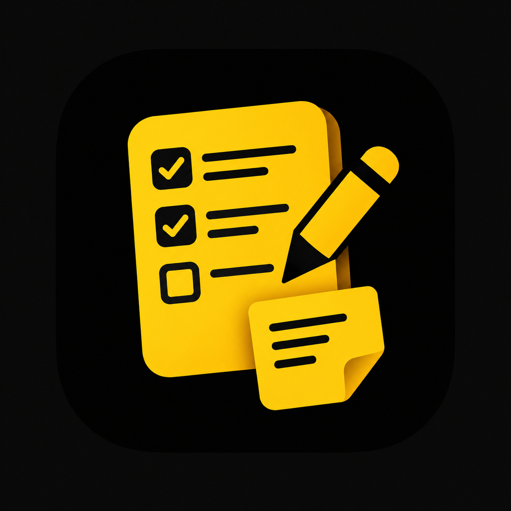

<div align="center">

  

  # Taskly

  **A modern, full-stack task & notes workspace designed for speed, clarity, and focus.**

  [](https://www.typescriptlang.org/)
  [](https://react.dev/)
  [](https://vitejs.dev/)
  [](https://tailwindcss.com/)
  [](https://nodejs.org/)
  [](https://expressjs.com/)
  [](https://www.mongodb.com/)
  [](https://vitest.dev/)

</div>

---

## 📖 Overview

**Taskly** is an all-in-one productivity suite that combines powerful task management, rich-text note taking, real-time analytics, and an intelligent AI assistant. Built entirely in **TypeScript** using **React 19**, **Vite**, **Express**, and **MongoDB**, Taskly features a distinctive **signature yellow and black aesthetic** inspired by its 3D logo.

Whether you prefer a tactile Kanban board, structured list views, or freeform rich-text notes with media attachments, Taskly helps you stay organized and get things done.

---

## ✨ Features

### 📋 Dual-View Task Management
- **Interactive Kanban Board:** Drag and drop tasks effortlessly across `To Do`, `In Progress`, and `Done` columns with smooth animations powered by `@dnd-kit`.
- **List View with Controls:** Filter tasks by status, category (`Work`, `Personal`, `Home`, `Urgent`), and priority (`High`, `Medium`, `Low`). Search by title and sort deterministically by creation date, due date, or priority rank with pagination.
- **Due Date Tracking:** Visual overdue indicators and smart badge alerts for past-due deadlines.

### 📝 Rich-Text Notes & Media
- **TipTap WYSIWYG Editor:** Write notes with formatting for headings, bullet/numbered lists, task items (checkboxes), blockquotes, code blocks, and links.
- **Media Attachments:** Upload images, audio recordings, and videos directly into your notes. Includes built-in voice memo recording with live waveform feedback.
- **Auto-Save Engine:** Automatic 1.5-second debounced background saving with optimistic concurrency control (`baseVersion`) to protect against conflicting edits across multiple tabs.
- **Categorization & Search:** Organize notes into custom color-coded categories with instant text search and snippet previews.

### 📊 Analytics & Insights Dashboard
- **KPI Summary Cards:** Real-time visibility into total tasks, completed count, overdue items, and completion rate percentage with animated progress bars.
- **Interactive Trend Charts:** Powered by **Recharts**, view tasks completed per day over configurable timeframes (7 days, 14 days, or 30 days).
- **Category Distribution Donut:** Visual breakdown of task distribution across categories with accessible data table fallbacks.

### 🤖 Taskly AI Assistant
- **Gemini-Powered Natural Language Actions:** Add, update, schedule, or organize tasks simply by chatting.
- **Voice-Enabled:** Supports browser speech recognition for hands-free voice input and speech synthesis audio replies.
- **Built-in Quota Guard:** In-memory rate limiting and token-conscious model fallbacks to keep assistant usage fast and cost-effective.

### 🎨 Signature Yellow & Black Design System
- **Tailwind CSS v4:** Bespoke golden-yellow palette (`#facc15` / `#eab308`) set against deep jet black and obsidian backgrounds (`#09090b` / `#121215`).
- **Smooth Theme Switcher:** Default dark mode featuring subtle warm ambient drift gradients, with instant light mode toggle and `localStorage` persistence.
- **Accessibility First:** High contrast ratios, full keyboard navigation traps, ARIA dialog roles, and screen reader announcements.

### 🔐 Private Browser Workspaces
- **No sign-in or sign-up:** Taskly opens directly to the workspace without checking an account.
- **Per-browser data isolation:** A signed, `httpOnly` workspace cookie scopes tasks, notes, and categories to the browser that created them.
- **Browser-bound access:** Clearing browser cookies or switching browsers/devices starts a separate workspace; workspaces are not shared or recoverable through an account.
- **Existing sessions:** A still-valid sign-in cookie is converted to a browser workspace on first use so its existing tasks and notes remain available.
- **Robust Validation:** Comprehensive request schemas validated via **Zod**, preventing NoSQL injection, parameter pollution, and mass assignment attacks.
- **Protection:** API rate limiters on media uploads, note writes, and AI actions.

---

## 🛠️ Tech Stack

| Domain | Technologies |
| :--- | :--- |
| **Frontend** | React 19, TypeScript, Vite, Tailwind CSS v4, TanStack Query (React Query), TipTap Editor, Recharts, @dnd-kit, Lucide Icons |
| **Backend** | Node.js (ES Modules), Express, TypeScript, Mongoose, Zod, Multer, Helmet, Cookie-Parser, JsonWebToken |
| **Database** | MongoDB |
| **Testing** | Vitest, React Testing Library, JSDOM, Supertest, MongoDB Memory Server |
| **Tools** | Oxlint, TSX |

---

## 🚀 Quick Start

### Prerequisites
- **Node.js**: `v20.19+` or `v22.12+`
- **npm**: `v9+`
- **MongoDB**: A running local MongoDB instance or a cloud MongoDB URI (e.g., MongoDB Atlas).

### 1. Clone the Repository
```bash
git clone https://github.com/your-username/taskly.git
cd taskly
```

### 2. Install Dependencies
Install dependencies for both frontend and backend:
```bash
npm --prefix client install
npm --prefix server install
```

### 3. Configure Environment Variables
Copy the example environment templates:

**On Linux/macOS:**
```bash
cp client/.env.example client/.env
cp server/.env.example server/.env
```

**On Windows (PowerShell):**
```powershell
Copy-Item client/.env.example client/.env
Copy-Item server/.env.example server/.env
```

### 4. Set Environment Configuration

#### Server (`server/.env`):
```env
PORT=5000
MONGODB_URI=mongodb://localhost:27017/taskly
CLIENT_URL=http://localhost:5173
MEDIA_STORAGE_DIR=uploads
JWT_SECRET=your_super_secret_jwt_key_here
NODE_ENV=development

# Optional: Google Gemini API Key for Taskly AI Assistant
GEMINI_API_KEY=your_gemini_api_key_here
GEMINI_MODELS=primary-model,fallback-model-1,fallback-model-2
AI_DAILY_CAP=200
AI_USER_PER_MINUTE=5
AI_USER_PER_DAY=30
```

#### Client (`client/.env`):
```env
VITE_API_BASE_URL=/api
```

### 5. Run the Application
Run both the frontend and backend concurrently with a single command from the root directory:
```bash
npm run dev
```

- **Frontend Application:** `http://localhost:5173`
- **Backend API:** `http://localhost:5000`
- **API Health Check:** `http://localhost:5000/api/health`

---

## 💻 Available Scripts

### Root Directory
- `npm run dev`: Starts both client (Vite) and server (Express via TSX) concurrently.
- `npm run dev:client`: Runs the client dev server only.
- `npm run dev:server`: Runs the backend API dev server only.

### Client (`client/`)
```bash
cd client
npm run dev       # Start Vite development server
npm run build     # Type-check with tsc and build production bundle with Vite
npm test          # Run client unit & component tests with Vitest
npm run lint      # Lint codebase with Oxlint
npm run preview   # Preview production build locally
```

### Server (`server/`)
```bash
cd server
npm run dev       # Start backend with TSX live-reload
npm run build     # Compile TypeScript to JavaScript in dist/
npm start         # Run compiled production server
npm test          # Run server API integration tests with Vitest & Supertest
```

---

## 📡 API Overview

| Route | Method | Description | Sign-in Required |
| :--- | :--- | :--- | :---: |
| `/api/health` | `GET` | Health check & database connection status | No |
| `/api/tasks` | `GET` | Paginated task list with filter & sort | No |
| `/api/tasks` | `POST` | Create a new task | No |
| `/api/tasks/:id` | `GET` | Get task details by ID | No |
| `/api/tasks/:id` | `PATCH` | Update task details | No |
| `/api/tasks/:id` | `DELETE` | Delete task | No |
| `/api/tasks/reorder` | `POST` | Reorder tasks within/across Kanban columns | No |
| `/api/tasks/stats` | `GET` | Retrieve task analytics & completion trends | No |
| `/api/notes` | `GET` | Get list of note summaries | No |
| `/api/notes` | `POST` | Create note | No |
| `/api/notes/:id` | `GET` | Get full note content | No |
| `/api/notes/:id` | `PATCH` | Update note with OCC baseVersion check | No |
| `/api/notes/:id` | `DELETE` | Delete note | No |
| `/api/notes/categories`| `GET/POST/PATCH` | Manage browser-workspace note categories | No |
| `/api/assistant/chat` | `POST` | Interact with the Taskly AI Assistant | No |

---

## 📁 Project Architecture

```
Tasky/
├── client/                     # Frontend Application (React 19 + Vite)
│   ├── public/                 # Static assets & favicons
│   │   ├── favicon.svg         # Yellow & black SVG favicon
│   │   ├── taskly-icon.svg     # App icon vector
│   │   └── taskly-logo.png     # 3D Yellow and Black Logo
│   ├── src/
│   │   ├── api/                # Typed API client & endpoints
│   │   ├── components/
│   │   │   ├── assistant/      # Taskly AI Assistant modal & voice input
│   │   │   ├── common/         # Button, Input, Select, Modal, Badge, Spinner
│   │   │   ├── layout/         # AppLayout, Header, Navigation
│   │   │   ├── notes/          # TipTap editor, toolbar, summaries, media
│   │   │   ├── stats/          # KPI cards, Recharts trend bar & donut charts
│   │   │   └── tasks/          # KanbanBoard, TaskCard, TaskControls, TaskModal
│   │   ├── context/            # ThemeContext, ToastContext
│   │   ├── hooks/              # Custom hooks (useTasks, useNotes, etc.)
│   │   ├── pages/              # DashboardPage, NotFound
│   │   ├── test/               # Vitest component & unit tests
│   │   ├── types/              # TypeScript interface definitions
│   │   ├── index.css           # Tailwind CSS v4 config & theme definitions
│   │   └── main.tsx            # React application entry point
│   ├── package.json
│   └── vite.config.ts
├── server/                     # Backend API (Node.js + Express)
│   ├── src/
│   │   ├── config/             # Database connection & env setup
│   │   ├── controllers/        # Route handlers (tasks, notes, assistant)
│   │   ├── middleware/         # Workspace, validation, rate limiting, error handling
│   │   ├── models/             # Mongoose schemas (Workspace, Task, Note, MediaAsset)
│   │   ├── routes/             # Express API routes
│   │   ├── services/           # Business logic & AI assistant service
│   │   ├── validation/         # Zod schemas
│   │   ├── app.ts              # Express application setup
│   │   └── server.ts           # Server bootstrap & database connect
│   ├── tests/                  # API integration test suite
│   └── package.json
├── scripts/                    # Development automation scripts
│   └── dev.mjs                 # Dual-service runner script
├── new_logo.png                # Master 3D yellow & black logo asset
├── AGENTS.md                   # Agent guidelines & project conventions
├── package.json                # Root workspace configuration
└── README.md                   # Project documentation
```

---

## 🎨 Theme & Accessibility

Taskly is tailored specifically with an eye-catching **Yellow & Black** palette:
- **Flagship Dark Mode:** Jet-black backdrop with glowing warm amber radial ambient lighting, golden borders, and yellow action accents.
- **Light Mode:** Warm parchment backdrop, crisp high-contrast dark charcoal text, and energetic yellow badges and buttons.
- **Accents:** Semantic emerald for completed states, warm amber for in-progress items, and rose for overdue warnings.
- **Full Keyboard & Screen Reader Support:** Accessible modal dialogs with focus traps, ARIA attributes across interactive components, and hidden data tables for charts.

---

## 📄 License

This project is open-source and available under the [MIT License](LICENSE).
